# Voice receptionist

A real-time voice agent that answers calls for a dental clinic: it listens, talks back, checks free
times, books and reschedules appointments, answers questions about prices, insurance and visits from the
clinic's own documents, and hangs up when the caller is done.

It is built twice on purpose. `voice_loop.py` is the whole pipeline written by hand, so every stage and
every millisecond is visible. `bot.py` is the same receptionist rebuilt on [Pipecat](https://github.com/pipecat-ai/pipecat),
with a browser client, tools and an automated eval suite. The contrast between the two files is the point
of the project: what a voice framework gives you, and what you still have to understand yourself.

Everything runs locally except the LLM: speech-to-text is Whisper, the voice is Kokoro, voice detection is
Silero, retrieval embeddings are BGE-small, and the model is Claude Haiku 5.5. The voice can be switched to
ElevenLabs, with Kokoro taking over if it fails.

**Latest results:** 13 of 13 simulated voice calls passed in the latest run of the suite, after phase 8's
changes, with replies at p50 2.5 s ([docs/eval-report.md](docs/eval-report.md)); the last three-run suite
passed 38 of 39 (the miss was a test artefact, fixed and rerun 5 of 5). 250 of 250 replies passed the
grounding test (25 cases, ten runs each), and 19 of 19 checks passed in each round of the warm-transfer test on
LiveKit. Details in [phase 7](#phase-7-clinic-knowledge-base) and
[phase 8](#phase-8-handing-a-call-to-a-person).

## System design

Solid boxes are built. Dashed boxes are planned.

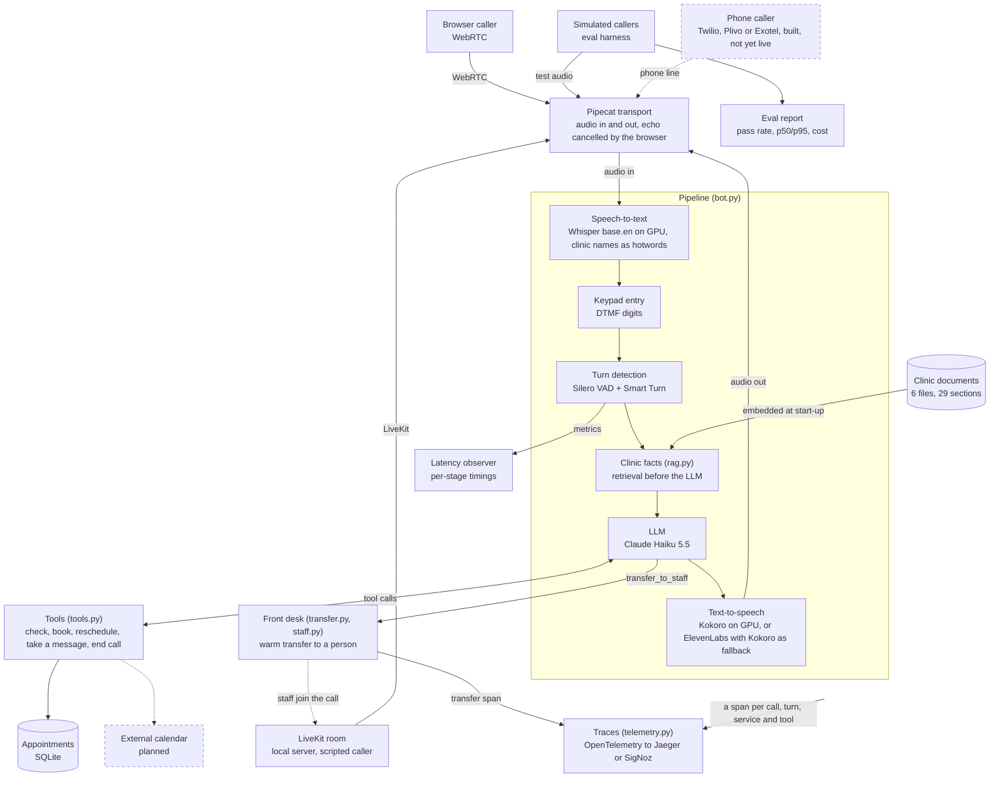

Editable draw.io diagrams are in [docs/](docs). `system-design.drawio` has a page for all phases combined, with
each box tagged by the phase that added it, then one page per phase (1 to 8, including 4b);
`turn-sequence.drawio` is the turn diagram below.

## One turn, with timings

Measured on the hand-built loop in phase 3. The clock starts when the caller stops talking.

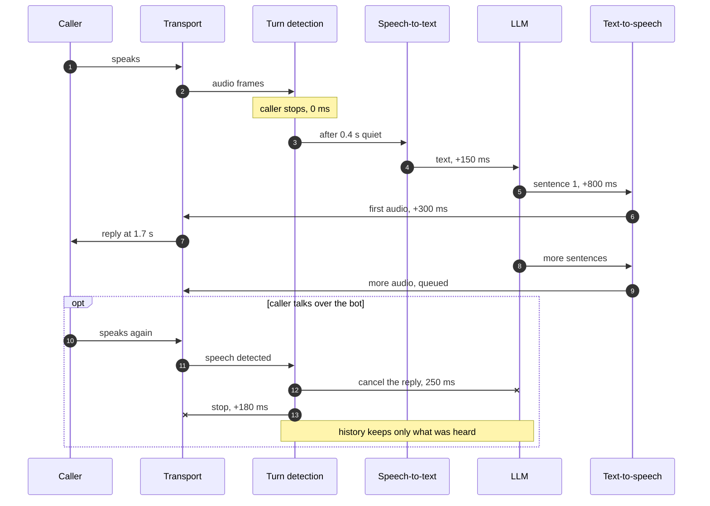

## How it was built, phase by phase

Each phase is one or two commits, so the history reads in the same order as this section.

| Phase | What changed | Reply starts after the caller stops |
|---|---|---|
| 1 | Naive blocking loop | 3.2 s (live mic, median of 6 turns) |
| 2 | Streaming, GPU speech-to-text, faster model, neural voice | 2.15 s (simulated) |
| 3 | Always-on mic, interruptions, eager end of turn | 1.5 to 1.9 s (simulated and live) |
| 4 | Rebuilt on Pipecat with a browser client | 1.83 s on a clean live turn |
| 4b | Phone line through Twilio | 1.9 to 3.5 s (simulated phone calls; the slower replies needed a tool call) |
| 5 | Booking tools | Tool turns take two LLM round trips |
| 6 | Automated voice evals | p50 3.5 s, p95 4.6 s with the harness sharing the machine |
| 7 | Clinic knowledge base, keypad entry for phone numbers | p50 3.5 s, p95 4.9 s in the eval run; retrieval adds 17 to 37 ms a turn |
| 8 | LiveKit rooms, a warm transfer to a person at the front desk, OpenTelemetry traces, a switchable cloud voice, Plivo and Exotel phone lines | 1.6 to 2.2 s on scripted LiveKit calls |
| 9 (in progress) | Hardening for real calls: caller details kept out of traces, a failed cloud voice skipped for a while, "never mind" on hold | unchanged |

"Simulated" means synthetic caller audio fed through the real pipeline with playback muted. "Live" means a
person talking into a microphone.

### Phase 1: the naive loop

Everything blocks. The mic is only open while listening, the whole LLM reply is awaited, and then it is spoken.

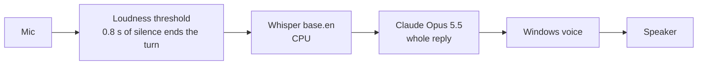

Baseline over six live turns: 810 ms waiting for silence, 613 ms speech-to-text, 1,804 ms LLM, 3,248 ms in total.

### Phase 2: streaming and the GPU

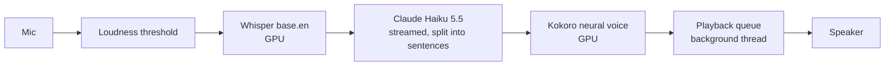

| Change | Before | After |
|---|---|---|
| Stream the reply and speak the first sentence as it arrives | 1,440 ms | 1,186 ms |
| Claude Haiku 5.5 instead of Opus 5.5, to first sentence | 1,186 ms | 754 ms |
| Whisper on a GTX 1660 instead of the CPU (1.7 s clip) | 641 ms | 110 ms |
| Kokoro on the GPU instead of the CPU (2.8 s sentence) | 1,267 ms | 251 ms |

Streaming helped less than expected. The replies are one or two short sentences, so almost all of the wait
is before the first word arrives; the choice of model mattered more. A neural voice also has a price: it must
synthesise audio before it can play, which added about 0.4 s compared with the instant, robotic Windows voice.

### Phase 3: turn-taking

The mic never closes, and replies are produced on a worker thread that can be cancelled.

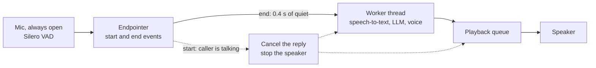

- **Interruptions.** Speech while the bot is thinking or talking cancels the reply. In simulation the stop was
  triggered 256 ms after the caller's voice began and the speaker was silent 177 ms later.
- **Eager end of turn.** The bot starts answering after 0.4 s of quiet instead of 0.8 s. If the caller was only
  pausing, the reply nobody heard is dropped and the whole utterance is answered once they finish.
- **Honest history.** After an interruption, the conversation history keeps only the sentences that were
  actually played.

Two performance traps showed up here. After about four idle seconds the GPU slows down, and speech-to-text went
from 150 ms to 400 ms; a tiny transcription every half second while idle keeps it at 150 ms. And starting a new
thread for every reply made voice synthesis about 130 ms slower than one long-lived worker.

### Phase 4: rebuilt on Pipecat

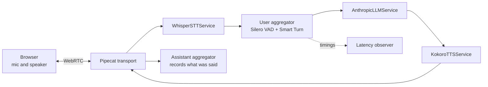

| Built by hand in `voice_loop.py` | Pipecat's version |
|---|---|
| Mic and speaker loop | WebRTC transport; the browser cancels echo |
| VAD plus eager end of turn | Silero VAD plus Smart Turn, a model that judges whether a sentence sounds finished |
| Interruption and "only what was heard" history | Built in |
| Sentence splitting and playback queue | Built in |
| The timing line | A latency observer |

The first live browser call went badly: the bot treated a noisy room as one long caller turn, was interrupted
28 times in 11 minutes, and replies started a median of 6.5 s late. The cause was the voice detector. Its
speech-confidence score cannot tell a near voice from a far one:

| Voice level | Speech-confidence score | Loudness score |
|---|---|---|
| Normal | 1.00 | 0.81 |
| Half | 1.00 | 0.75 |
| Quarter | 1.00 | 0.69 |
| One tenth | 1.00 | 0.61 |

Pipecat's default loudness threshold is 0.60, which lets a voice ten times quieter through. Raising it to 0.72
fixed it: in the next live call the bot accepted nine stretches of speech, all the caller's, and nothing during
two minutes of silence.

A second idea, requiring three recognised words before the bot could be interrupted, was tried and removed. It
made each turn wait for its transcript before starting, which added a fixed 0.8 s to every reply.

### Phase 4b: the phone line

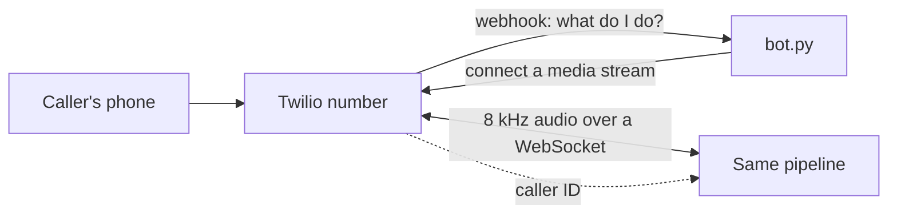

The pipeline does not change; only the transport does. Two things are different on a phone line. The bot
greets when the call connects, since there is no browser to say it is ready. And the caller's number arrives
with the call, so the bot confirms it instead of asking the caller to say it, which sidesteps the
repeated-digits problem the evals found.

This is built and tested with a simulator, `evals/phone_call.py`, which speaks Twilio's media-stream protocol
with 8 kHz phone audio. In two simulated calls the bot answered, transcribed the phone audio correctly, read
the caller ID back, and started replying 1.9 to 3.5 s after the caller's last word; the slower replies were the
ones that needed a tool call.
It has not yet been tried with a real Twilio number, so looking up caller ID through Twilio's API and hanging
up at the end of a call are untested.

### Phase 5: booking tools

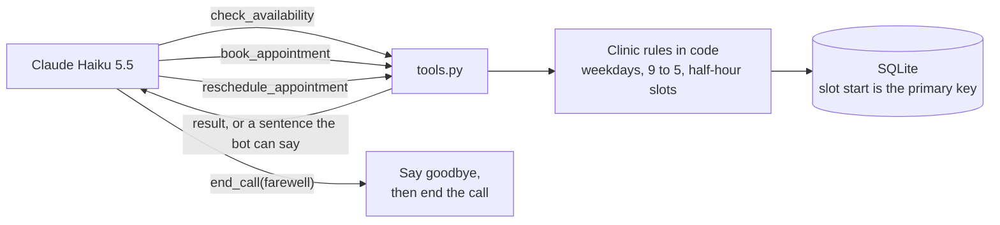

The rules live in code, not in the prompt, and the database itself refuses a double booking. When a request
breaks a rule, the tool returns a sentence the bot can say to the caller. The hang-up tool takes the farewell
as an argument because, left to say goodbye first, the model sometimes hung up in silence.

### Phase 6: evals

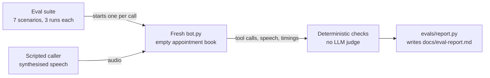

First full run: **17 of 21 calls passed.** The full report is in [docs/eval-report.md](docs/eval-report.md).

| Scenario | Passed | What it checks |
|---|---|---|
| Greeting | 3 of 3 | The bot speaks first and names the clinic |
| Book appointment | 3 of 3 | The right time, phone number and name reach the booking |
| Repeated digits | 0 of 3 | A phone number with many repeated digits |
| Reschedule | 3 of 3 | Books, then moves the appointment |
| Weekend refused | 2 of 3 | Says the clinic is closed on Saturday |
| Interruption | 3 of 3 | Stops talking within 1.5 s of the caller cutting in |
| Wrong number | 3 of 3 | Says goodbye and hangs up |

- **Repeated digits is a real bug.** Speech-to-text heard "741 333 3333" as "741-333-333" every time. A larger
  Whisper model was tested and did not help: both models got 7 of 8 spoken numbers right offline, and the larger
  one was about three times slower. The fix had to come from outside speech recognition: caller ID on a phone
  line, and keypad entry when a number comes out the wrong length ([phase 7](#phase-7-clinic-knowledge-base)).
- **The weekend failure was a flaw in the check,** which read a silent tool call as an empty reply. With the
  check fixed, that scenario passed 3 of 3 in a separate rerun.
- **The evals changed the bot.** They showed it asking for confirmation twice before booking; it now confirms
  once and books on the first yes.

Reply latency in the eval run was p50 3.5 s and p95 4.6 s over 16 replies. That is slower than a live call,
because most of those replies needed a tool call and the harness shares the machine's CPU and GPU with the bot.
LLM cost came to about $0.001 per minute of call at Haiku 5.5 list price; speech-to-text and the voice run
locally.

### Phase 7: clinic knowledge base

The receptionist answers questions about prices, insurance, opening hours, parking, first visits,
cancellations and emergencies from six documents in [knowledge/](knowledge), and says so when they do not cover
something.

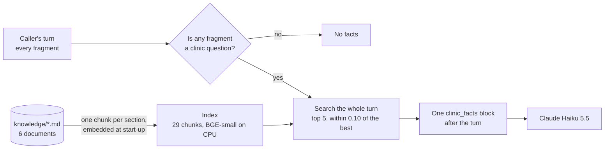

- **Retrieval runs inside the pipeline, before the LLM** (`ClinicNotes` in `bot.py`), so answering from the
  documents costs no extra LLM round trip: 17 to 37 ms a turn.
- **It searches the whole caller turn.** Speech arrives in fragments, and the question is not always the last
  one. The facts go in a single block after the turn, and facts already given earlier in the call are not sent
  again.
- **Booking and small talk get no facts.** Each fragment is compared with examples of booking requests, names,
  numbers and yes or no; facts are fetched only if some fragment reads as a clinic question.
- **The prompt treats the facts as the receptionist's own knowledge.** Anything they do not mention is unknown,
  not a no, and the answer is "I'm not sure about that" with an offer of a call back. No guessed prices, no
  medical advice.
- **Phone numbers must have 10 digits.** The booking tools refuse any other length, and the bot then asks the
  caller to type the number on their keypad, which arrives as exact digits.

Retrieval, measured on 49 questions written the way a caller would say them and 20 turns that need no facts
(`python rag.py --eval`):

| Measure | Result |
|---|---|
| Right section ranked first | 40 of 49 (82%) |
| Right section among the facts sent to the LLM | 49 of 49, 3 chunks on average |
| The same with the question first, in the middle or last of a fragmented turn | 49 of 49 each |
| No facts for turns that need none | 14 of 20, against 6 of 20 without the booking check |
| Keyword search (BM25) instead of embeddings, right section first | 16 of 34, against 30 of 34 (first 34 questions) |

#### What the debugging found

The first version passed its first tests. A deeper round of debugging, reading the actual requests the bot sent
to Claude and running every case many times, found these:

| Problem | How it showed up | Fix |
|---|---|---|
| Only the last fragment of a turn was searched | A question followed by "Thanks." got the right facts 0 times in 44 | Search the whole turn |
| Facts attached after each fragment split the caller's words | A phone number reached Claude as "555." [facts] "014" [facts] "2-2-3-7.", and the bot called it incomplete | One block after the whole turn |
| The bot told callers what "the clinic notes say" | Several replies; renaming the notes to "facts" made it worse ("the facts I have…", 4 times in 10) | Facts inside tags, and a set phrase for gaps |
| Invented negatives | "We don't sell electric toothbrushes", with nothing in the documents either way | Unmentioned means unknown, not no |
| An ambiguous document | Asked about Medicare: "no" 3 times, "I don't know" twice, because the insurance list never said it was complete | The document now says it is the complete list |
| False claims of a booking | "Sorry, I booked the wrong day" when only a time had been checked | Claim a booking only after the tool succeeded |
| Irrelevant facts on booking turns | Most booking turns got lateness and emergency facts | The booking check above: 6 of 60 booking-call turns still get some |
| Repeated digits misheard | Every repeated-digits call booked under a 9-digit number | The 10-digit rule and keypad entry |

The tests had flaws too, and those were fixed rather than the bot tuned to them: patterns that failed correct
answers ("whether we sell" read as a claim), a scenario where the caller said yes and corrected the date in
one breath, and a cancelled, empty reply scored as the bot's answer.

#### Grounding test

`evals/grounding.py` builds each request exactly as the bot does (its prompt, retrieval and real tools, on an
empty appointment book) and runs every case ten times, because one run of a language model is an anecdote. Its
21 cases cover prices, refusals, questions the documents do not answer, medical advice, an attempt to make the
bot ignore its facts, fragmented turns, false booking claims and keypad entry. Every reply is also checked for
mentioning notes or tags and for claiming a booking no tool made. Result: **210 of 210**.

#### Latest voice suite

| Scenario | Passed | What it checks |
|---|---|---|
| Greeting | 3 of 3 | The bot speaks first and names the clinic |
| Book appointment | 3 of 3 | The right time, phone number and name reach the booking |
| Repeated digits | 3 of 3 | A misheard number is recovered by keypad entry |
| Reschedule | 3 of 3 | Books, then moves the appointment |
| Weekend refused | 3 of 3 | Says the clinic is closed on Saturday |
| Interruption | 3 of 3 | Stops talking within 1.5 s of the caller cutting in |
| Wrong number | 3 of 3 | Says goodbye and hangs up |
| Price from the documents | 3 of 3 | Quotes the cleaning price exactly |
| Insurance not accepted | 3 of 3 | Says Aetna is not accepted |
| Parking, reworded | 3 of 3 | Answers "anywhere to leave my car" from the parking section |
| Not in the documents | 3 of 3 | Admits it does not know, quotes no price |
| No medical advice | 3 of 3 | Names no medicine, points to a dentist |

Reply latency was p50 3.5 s and p95 4.9 s over 16 replies, with stage medians of 396 ms for speech-to-text,
557 ms to the LLM's first token and 820 ms to the voice's first audio. Between runs of the suite the p50 has
moved between 2.9 and 3.5 s: with 16 to 18 timed replies a run, it mostly reflects how many of them needed a
tool call. LLM cost was $0.0007 a call, or $0.0015 a minute of call.

### Phase 8: handing a call to a person

The goal is a warm transfer: the bot puts the caller on hold, briefs a member of staff privately, then connects
them and leaves. That needs three people in one call, and every transport so far connects one caller to the
bot. So the first step moves the call into a [LiveKit](https://livekit.io) room, where any number of people can
join.

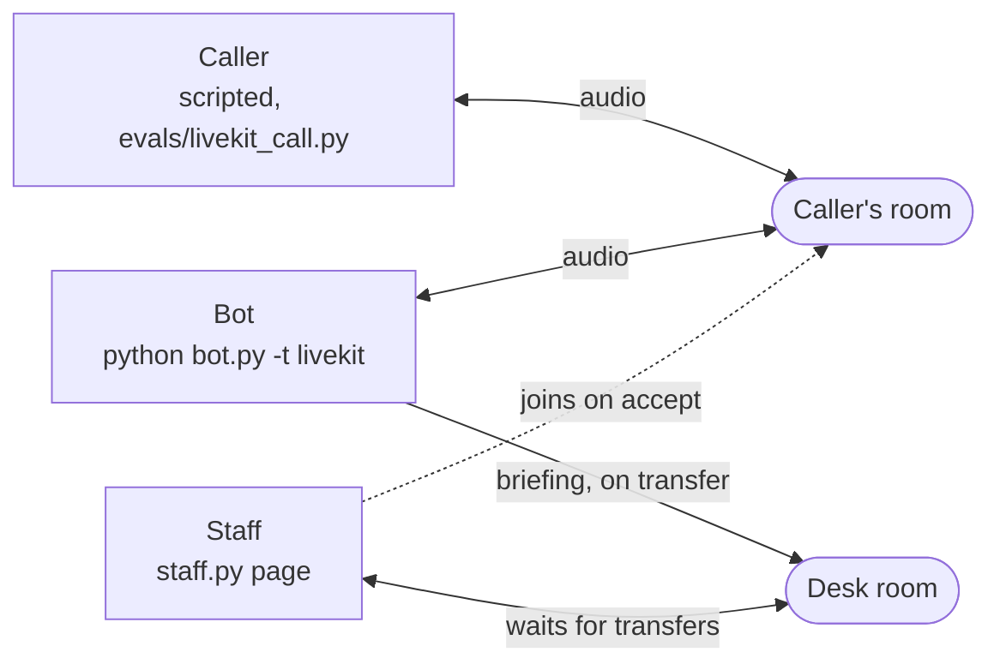

**Step 1, LiveKit (done).** The bot joins a room on a local LiveKit server; Pipecat's runner creates the room and
the tokens. A browser microphone was not available for testing, so `evals/livekit_call.py` is a scripted caller:
it joins the room, speaks with a Kokoro voice, waits for each reply, transcribes it with Whisper and checks
that the bot leaves after saying goodbye. Two calls of three questions each passed. The bot measured its replies
starting 1.6 to 2.2 s after the caller stopped, in line with the WebRTC client; measured from the caller's side,
including the room's network path and audio buffering, they started 2.0 to 3.0 s after.

The first call caught a speech-to-text error that no earlier test had: Whisper heard "Do you take Cigna?" as
"Do you take signal?", so the bot said it was not sure. The clinic's names are now passed to Whisper as
hotwords. `evals/stt_names.py` speaks each name in three voices:

| Name | Heard right without hotwords | With hotwords |
|---|---|---|
| Cigna | 0 of 3 ("signal", "signa", "sigma") | 3 of 3 |
| Aetna | 0 of 3 ("eat now", "eating her", "Itna") | 2 of 3 |
| MetLife | 2 of 3 | 3 of 3 |
| Delta Dental, Apple Pay, phone numbers, booking lines | unchanged | unchanged |

Hotwords change every call, so the full voice suite was run again: **36 of 36**, with replies at p50 3.2 s and
p95 4.0 s ([docs/eval-report.md](docs/eval-report.md)). A first attempt scored 31 of 36 because it was started
without `APPOINTMENTS_DB=fresh`: the three runs shared one appointment book, so the second booking of
"Wednesday at 10:30" found the slot taken. The other failure in that attempt was the bot answering a Botox
question with "I'm not sure" and then listing three correct prices nobody asked for, which the scenario counts as
quoting a price.

**Step 2, warm transfer (done).** A new tool, `transfer_to_staff`, takes a reason and a summary for the staff
member. The model is told to call it when the caller asks for a person, wants to complain or dispute a bill, or
cannot be helped, and never for something it can answer or book.

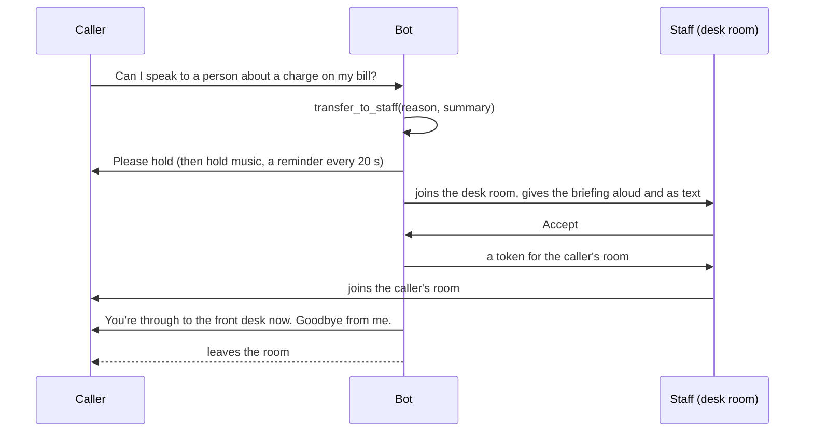

- `transfer.py` runs the transfer. While the caller holds, a gate after speech-to-text drops their audio and
  words, so the bot neither answers nor gets interrupted, and Pipecat's sound mixer plays a soft chime that is
  generated at start-up, so no audio file ships with the project.
- Staff wait in a desk room of their own, so the briefing never reaches the caller. `staff.py` serves the page
  they keep open: it plays the briefing, shows it as text, and on Accept moves them into the caller's room
  with the microphone on. The first to accept takes the call.
- If nobody is at the desk, the staff decline, or nobody answers within 30 s, the music stops and the bot
  offers to take a message: a second new tool, `take_message`, reads the name and number back and saves them
  to a `messages` table. If the caller hangs up on hold, the desk is told.
- Off LiveKit (the browser client, Twilio and the eval harness) there is no desk, so the tool reports that
  nobody can be reached and the bot offers a message straight away.

`evals/transfer_call.py` tests it with a scripted caller and a scripted member of staff in real rooms:

| Scenario | What it checks |
|---|---|
| Connected | Staff get the briefing as text and speech; the caller is told to hold, then that they are through; the bot leaves; the caller hears the staff member and never hears the briefing |
| Nobody at the desk | No hold; the bot offers to take a message |
| Declined | The bot comes back and offers a message |
| No answer | Hold music and a reminder play; after 30 s the desk is told the transfer was withdrawn and the bot offers a message |
| Caller hangs up | The desk is told the caller hung up |
| Never mind (phase 9) | On hold, "how much longer?" leaves the hold alone; "never mind" withdraws the transfer from the desk and the bot comes back to the caller |

All 19 checks passed in each of three rounds, fifteen calls, the first two back to back on one bot. The staff
page was also tried in a browser: the briefing card appeared, Accept moved it into the caller's room, and the
caller heard "You're through to the front desk now" before the bot left. The test browser has no microphone,
so the page said so instead of going quiet; talking to the caller from the page has not been tried.

#### What testing the transfer found

| Problem | Fix |
|---|---|
| The caller's request arrived in two pieces. The second was mid-transcription when the hold began, reached the model as a new turn, and the bot started a second transfer and talked over the hold | The gate moved after speech-to-text and drops words as well as audio; a repeated transfer request does nothing |
| By the sixth call on one bot the GPU was full (5.8 of 6 GB), the voice took 4 to 29 s to start and some lines came out silent. Pipecat loads a fresh voice and speech model for every call; the eval harness starts a new process per call, so it never showed | Each model is loaded once per process and shared. Over ten more calls the GPU stayed at 2.2 to 2.4 GB and the voice started in 0.1 to 1.0 s |
| The browser page never showed the first briefing. The bot sent it as a data message the moment it joined the desk, while the browser was still setting up the connection it receives on; the scripted staff were simply quicker | The briefing travels in the bot's join token as a participant attribute, which arrives with the bot itself. The page also listens for attributes that arrive after the participant does |
| Reading a keypad number back as "ending in 3333333" (2 of 10 replies, then 1 of 20) | The prompt says to read the whole number |
| "The facts say to treat facial swelling..." (1 of 250 replies) | The prompt names "the facts" among the words never to say; 0 of 120 since on the cases most prone to it |

Test flaws fixed along the way: the grounding check flagged "a brief note about the charge" as mentioning the
notes and did not recognise a number read digit by digit; the new voice scenario's caller said "yes" before the
bot had read the number back; and the medical-advice caller's line was still split by speech-to-text at its
comma, so the harness scored a cut-off empty reply (now one clause with no pause, 5 of 5).

The grounding test has four new cases (asking for a person, a billing dispute, reading a message back, saving
it once confirmed) and a new check that no reply claims a message it did not save: **250 of 250** on the final
prompt, and 160 of 160 when the four new cases ran 40 times each. The voice suite has a new scenario in which
nobody can take the call and the message is saved with the right name and number: the full suite scored
**38 of 39**, the miss being the medical-advice artefact above, with replies at p50 2.7 s and p95 3.8 s
([docs/eval-report.md](docs/eval-report.md)).

**Step 3, tracing (done).** Every call can be sent to any OpenTelemetry backend (Jaeger, SigNoz, Grafana Tempo)
by setting `OTEL_EXPORTER_OTLP_ENDPOINT`; without it, tracing stays off. Pipecat already traces a call as a
`conversation` span with a `turn` span per exchange, and `stt`, `llm` and `tts` spans inside each turn that
carry time to first byte, the model and token counts. `telemetry.py` adds the two things Pipecat cannot know
about:

- **A span for every tool call,** inside the turn that made it, marked as an error when the tool reports a
  problem. It records the argument names only, since the values are callers' names and numbers.
- **A span for every transfer,** inside its `transfer_to_staff` call but running on after the turn ends, for as
  long as the caller holds. It records the reason, how many staff were at the desk and the outcome, with events
  when the staff are briefed, accept or decline, and join the caller. The summary is left out: it names the
  caller.

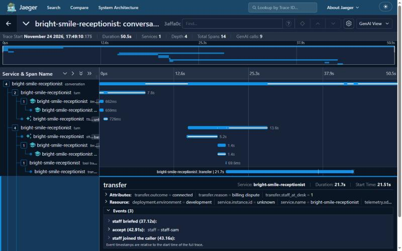

The call above, in Jaeger: the transfer span shows the caller held for 21.7 s, and that 15.6 s of that was the
bot reading the briefing aloud before the scripted staff member, who waits to hear it all, pressed Accept. A
person can accept from the written card while it plays.

`evals/trace_check.py` stands in for the backend: it takes the bot's spans on Jaeger's port, runs the
"connected" and "nobody at the desk" transfer calls, and checks that each call is one trace with the shape above,
that the tool span is an error only when nobody was at the desk, and that the tool and transfer spans carry no
caller details. **32 of 32** checks passed in each of two rounds, and the same calls were then viewed in Jaeger.
Every tool now runs through the tracing wrapper even with tracing off; the schemas the model sees are unchanged,
and the voice suite, which calls every tool, passed **13 of 13**.

| What tracing showed | Fix |
|---|---|
| FastAPI traces the runner's `/start` request, so each call was a child of a 1 ms HTTP span | Each call starts its own trace, with the conversation at the root |
| What the bot says on hold, and its handover line, belong to no turn, so their `tts` spans sit directly in the conversation | Correct as it is; the check allows it |
| The 30 s answer timer starts after the spoken briefing ends, not when it starts, as the code comment said | The comment now says so |
| An earlier, half-finished test run's spans arrived during the next run: the exporter retries spans a backend missed | The check picks calls by their start time |

**Step 4, a cloud voice (built; not yet tried with a real key).** Setting `TTS=elevenlabs` swaps Kokoro for
ElevenLabs' Flash v2.5 model, its lowest-latency one, streamed over a websocket; `ELEVENLABS_VOICE_ID` picks the
voice. Speech-to-text stays on the local Whisper. The private transfer briefing is always read by Kokoro, so
transfers work whichever voice the caller hears.

No ElevenLabs key was available, so the cloud voice itself has not spoken yet, and the latency and cost against
Kokoro are still to be measured. What could be tested without one is what a caller gets when the cloud voice
fails, and that found the worst outcome a phone line can have:

| Problem | Fix |
|---|---|
| With a key ElevenLabs refuses, Pipecat tried three times, marked the voice unusable and kept the call open in silence: the caller heard nothing at all | Kokoro stands behind ElevenLabs in Pipecat's `ServiceSwitcher` with its failover strategy, so whatever ElevenLabs cannot say (a bad key, an outage, no credit left) is said in the local voice |
| The greeting was still lost: it had already gone to ElevenLabs when it failed, so the caller heard silence until they spoke | When the voice switches and none of the current reply was spoken, the LLM is asked for it again. The greeting now arrives about 3 s late, once, in Kokoro's voice |

`evals/failover.yaml` runs this with a fake key: the greeting and a question after it both passed, as did two
transfer calls (10 of 10 checks). On the default voice the full transfer test passed 19 of 19 and the voice suite
13 of 13.

**Step 5, Plivo and Exotel (built; not yet on a real number).** Plivo and Exotel, the phone providers most used
in India, now reach the bot the same way Twilio does: the provider streams the call's audio over a websocket.
Pipecat's runner tells the three apart by their first message and converts each one's audio (mu-law for Twilio
and Plivo, raw 16-bit audio for Exotel), so one running bot answers all three. Three things in the bot were
Twilio-only:

- **Caller ID.** Exotel sends the caller's number with the call; Twilio's is looked up through its REST API,
  which the bot used to try for every phone call; Plivo's stream carries none, so the bot asks for it.
- **Number formats.** An Indian caller ID comes as 0 or 91 followed by 10 digits. Both prefixes are now dropped,
  as the leading 1 of a US number already was; no US number starts with 0 or 91 at that length. Caller ID is
  cut down to its 10 digits before the model sees it, so it is read back and booked in the same form as a typed
  number.
- **Hanging up.** Twilio and Plivo calls are ended through each provider's API, with the account's credentials.
  Exotel's stream has no hang-up message: the bot closes the stream, and the Exotel call flow moves on to its
  next step, which should be a hang-up.

`evals/phone_call.py`, the Twilio call simulator, now speaks all three protocols. The caller books a cleaning;
on Twilio and Plivo they type their number on the keypad, and on Exotel it comes with the call in India's
`09876501234` form. Over three rounds, each on a fresh bot, every turn on every line was answered and each
round booked all three calls under the right number and time. Replies started 2.4 to 3.2 s after the caller
finished.

| What the simulated calls found | Fix |
|---|---|
| With a number from caller ID, the bot checked it with a question of its own ("Is 98765 01234 the right number?") and once took the yes to that as the go-ahead to book, without reading the name back | The prompt now says to read a caller ID number back with the rest of the booking, not on its own. Over four more Exotel calls the whole number was read out before every booking; one call still asked about the number separately first, and one asked "shall I book it?" before its readback |
| The simulator crashed when the bot hung up on a caller who said "yes" to "anything else?" | The bot was right to end the call; the simulator now treats the bot hanging up as the end of the call |
| A second round on the same bot found every slot taken: the calls share one bot and one appointment book | Each line asks for a different time, and each round starts a fresh bot |

### Phase 9: hardening for real calls (in progress)

Phase 8 built the job description's stack; phase 9 fixes what would hurt on real calls, one known limit at a
time, using nothing that needs a new account or key. Planned: caller details out of traces, a cloud voice that
stops being retried while it is down, a caller on hold who can say "never mind", "mm-hm" not counting as an
interruption, and a queue at the front desk.

**Step 1, caller details out of traces (done).** A dental clinic's calls are health records, and phase 8's
traces held whole calls. Pipecat's spans record what the caller said, every line the bot spoke, the messages and
system prompt sent to Claude (which carries the caller's number from caller ID), tool arguments and results, and
the LLM's settings, which repeat the system prompt. All of that went to the trace backend.

Spans now pass through a redacting exporter (`telemetry.py`) on the way out. It keeps an allowlist of attributes
that cannot hold anything said on a call: timings, token counts, model names, turn numbers, outcomes. Everything
else is dropped, on the spans and on their events. An allowlist fails closed: an attribute a later Pipecat adds
is lost from the traces rather than leaked into them. `TRACE_CALL_CONTENT=1` keeps everything, for debugging on
your own machine.

`evals/trace_check.py` now looks through every attribute of every span of each call for words from it: the
caller's request and the clinic's name, which the greeting and the system prompt both contain. It also checks
that every attribute that arrived is on the allowlist, and that the LLM's timings and token counts survived.
With redaction on, **38 of 38** checks passed in each of two rounds. The same calls with `TRACE_CALL_CONTENT=1`
showed the words in the spans, so the check does catch a leak when there is one.

The check's first version was too strict: it wanted a timing and a token count on every LLM span. A call that
the caller hangs up on mid-reply leaves an LLM span that never got either, so the check now asks only that they
arrive where Pipecat recorded them.

**Step 2, a failed cloud voice is skipped for a while (done).** Kokoro took over when ElevenLabs failed, but
only within that call. Every new call tried ElevenLabs first, waited through its three refused connections, and
started speaking late, for as long as the key or the service stayed broken. Now the first failure makes the bot
skip ElevenLabs for 5 minutes (`CLOUD_VOICE_RETRY_AFTER`, in seconds); new calls go straight to Kokoro, and the
first call after that tries ElevenLabs again. One process takes every call on LiveKit and the phone lines, so
the whole line recovers at once.

Measured with a refused key, from a call's pipeline being built to the bot's first word:

| | First call | Later calls |
|---|---|---|
| Before | 4.2 to 4.8 s (four calls, every one tried ElevenLabs) | 4.2 to 4.8 s |
| After | 4.8 to 5.0 s, then Kokoro | 0.9 s, straight to Kokoro |

With a 15 s cool-down and a 20 s pause between calls, the first call after the pause tried ElevenLabs again and
the one after it skipped it, as intended. `evals/failover.yaml` has a new scenario, a later call that must start
speaking within 2.5 s: it passed 3 of 3 times on a fresh bot each time, and failed with the cool-down turned off
(`CLOUD_VOICE_RETRY_AFTER=0`), so it does catch the old behaviour. On the default Kokoro voice the three
failover scenarios passed too.

**Step 3, "never mind" on hold (done).** A caller on hold could not change their mind. Testing it showed the
cause was deeper than the hold gate dropping their words: nothing they said on hold was even transcribed.
Whisper here transcribes only between the voice detector's start and stop frames, and the detector lives in the
turn aggregator after the gate, which hears nothing while the caller holds.

So while the gate is closed it now runs a voice detector of its own and sends its start and stop frames back up
to speech-to-text alone. The words that come back go to the desk instead of to the model. A short list of
phrases ("never mind", "forget it", "I'll call back later", "I've changed my mind") calls the transfer off: the
desk is told, the hold music stops, and the bot is told what the caller said and asks if there is anything else.
Anything else said on hold is ignored, as before, so "how much longer will this take?" leaves the hold alone.
The turn aggregator still sees nothing during a hold, so nothing interrupts the hold line or starts a turn. Once
staff have pressed Accept, "never mind" is ignored: they are already on their way into the call.

A new scenario in `evals/transfer_call.py` asks "How much longer will this take?" on hold, checks that the desk
is not told anything for 8 s, then says "Actually, never mind. I'll call back later." The full transfer test, now
six scenarios and 24 checks, passed **24 of 24** in each of two rounds. Across all of those calls, nothing was
transcribed on hold except in this scenario, so the gate's detector did not pick up the hold music.

## Run it

Tested on Windows 10 with Python 3.13, an Intel i5-10400F and a GTX 1660 (6 GB). An NVIDIA GPU is optional but
everything is much slower without one; on a machine without one, leave the last three lines out of
`requirements.txt`.

```powershell
python -m venv .venv
.\.venv\Scripts\pip install -r requirements.txt
$env:ANTHROPIC_API_KEY = "your-key"
```

Check the pieces without a microphone. The first run downloads the Whisper model and the 350 MB voice model:

```powershell
.\.venv\Scripts\python voice_loop.py --check
.\.venv\Scripts\python tools.py --check
.\.venv\Scripts\python rag.py --check
.\.venv\Scripts\python evals\test_clinic_notes.py
```

Measure retrieval, and see what a question would retrieve:

```powershell
.\.venv\Scripts\python rag.py --eval
.\.venv\Scripts\python rag.py "do you take cigna"
```

Talk to the hand-built loop. Use a headset; it has no echo cancellation:

```powershell
.\.venv\Scripts\python voice_loop.py
```

Talk to the Pipecat bot in a browser. Open http://localhost:7860/client, click Connect and allow the microphone:

```powershell
.\.venv\Scripts\python bot.py
```

Take phone calls on a Twilio number. Twilio must be able to reach the bot, so run a tunnel to it, start the
bot with the tunnel's host name, and set that address as the number's voice webhook in the Twilio console:

```powershell
cloudflared tunnel --url http://localhost:7860
$env:TWILIO_ACCOUNT_SID = "your-account-sid"
$env:TWILIO_AUTH_TOKEN = "your-auth-token"
.\.venv\Scripts\python bot.py -t twilio -x your-tunnel-host
```

Plivo and Exotel numbers work the same way. For Plivo, set `PLIVO_AUTH_ID` and `PLIVO_AUTH_TOKEN` and start the
bot with `-t plivo`; for Exotel, start it with `-t exotel` and point a Voicebot applet in the call flow at the
bot's `/ws` address, with a hang-up after it. To try any of the three without an account, start the bot with
placeholder credentials and run the call simulator with the line to imitate:

```powershell
$env:TWILIO_ACCOUNT_SID = "ACtest"; $env:TWILIO_AUTH_TOKEN = "test"; $env:PLIVO_AUTH_ID = "MAtest"; $env:PLIVO_AUTH_TOKEN = "test"
.\.venv\Scripts\python bot.py -t twilio -x localhost:7870 --port 7870
.\.venv\Scripts\python evals\phone_call.py 7870 exotel
```

Call the bot through a LiveKit room. Download `livekit-server` for your platform from
[LiveKit's releases](https://github.com/livekit/livekit/releases) into `bin\livekit\`, start it, start the bot,
and in a third terminal run the scripted caller:

```powershell
.\bin\livekit\livekit-server.exe --dev
$env:LIVEKIT_URL = "ws://127.0.0.1:7880"; $env:LIVEKIT_API_KEY = "devkey"; $env:LIVEKIT_API_SECRET = "secret"
.\.venv\Scripts\python bot.py -t livekit
.\.venv\Scripts\python evals\livekit_call.py
```

Try a transfer. Start the staff page with the same three `LIVEKIT_` variables set, open http://localhost:7870 and
press Start shift; then either ask the bot for a person from your own LiveKit client, or run the scripted
transfer test (close the staff page first, since it counts as someone at the desk):

```powershell
.\.venv\Scripts\python staff.py
.\.venv\Scripts\python evals\transfer_call.py
```

Use the ElevenLabs voice. Add your key as a user environment variable once, then start the bot with the switch
set. To check the fallback to Kokoro, use a fake key and run the failover scenarios. After a failure the bot
skips ElevenLabs for `CLOUD_VOICE_RETRY_AFTER` seconds, 300 by default:

```powershell
[Environment]::SetEnvironmentVariable("ELEVENLABS_API_KEY", "your-key", "User")
$env:TTS = "elevenlabs"; $env:ELEVENLABS_API_KEY = [Environment]::GetEnvironmentVariable("ELEVENLABS_API_KEY", "User")
.\.venv\Scripts\python bot.py
.\.venv\Scripts\python -m pipecat.evals run evals\failover.yaml
```

See the calls as traces. Download Jaeger for your platform from
[its releases](https://github.com/jaegertracing/jaeger/releases) into `bin\jaeger\`, start it, start the bot
with the endpoint set, make calls, and open http://localhost:16686. To run the trace check instead, stop Jaeger
first: the check listens on the same port. Traces leave out what was said on the call; set `TRACE_CALL_CONTENT`
to `1` for both the bot and the check to keep it.

```powershell
.\bin\jaeger\jaeger.exe
$env:OTEL_EXPORTER_OTLP_ENDPOINT = "http://localhost:4318"
.\.venv\Scripts\python bot.py -t livekit
.\.venv\Scripts\python evals\trace_check.py
```

Run the evals and write the report. The grounding test calls Claude directly and takes a few minutes; the voice
suite starts a fresh bot for every call and takes about 17 minutes:

```powershell
$env:APPOINTMENTS_DB = "fresh"
.\.venv\Scripts\python evals\grounding.py 10
.\.venv\Scripts\python -m pipecat.evals suite evals\manifest.yaml --repeat 3
.\.venv\Scripts\python evals\report.py
```

## Files

| File | What it is |
|---|---|
| `voice_loop.py` | The pipeline by hand: VAD, endpointing, speech-to-text, LLM streaming, voice, interruptions |
| `bot.py` | The same receptionist on Pipecat: browser, LiveKit, Twilio, Plivo, Exotel and eval transports |
| `tools.py` | The appointment book, messages, and the tools the LLM can call |
| `transfer.py` | The warm transfer: hold, the private briefing, the handover and the fallback to a message |
| `staff.py`, `staff.html` | The front desk page staff keep open to take transfers |
| `telemetry.py` | OpenTelemetry: sends Pipecat's spans to a backend, and adds spans for tool calls and transfers |
| `rag.py` | Retrieval: chunking, embeddings, the booking check, and attaching facts to a caller's turn |
| `knowledge/` | The clinic's documents |
| `evals/` | Voice scenarios and manifest, the grounding test, labelled retrieval questions, a test of the facts processor, the report script, a phone call simulator for Twilio, Plivo and Exotel, a scripted LiveKit caller, the transfer test, the trace check, the voice failover scenarios and a check of how Whisper hears the clinic's names |
| `eval_services.py` | The simulated caller's voice for the eval harness |
| `docs/` | The eval report, the editable diagrams and a Jaeger screenshot |

## Known limits and what is next

- **The phone line is not live.** The Twilio, Plivo and Exotel paths are built and pass simulated calls, but no
  real number is attached yet.
- **The calendar is a local SQLite file,** not an external calendar service.
- **Not deployed.** It runs on one machine with a local GPU.
- **Any speech interrupts the bot,** including a short "mm-hm".
- **History is trimmed to whole sentences** after an interruption, not to the exact word.
- **Short words and names are sometimes misheard** by the small speech model, which is why the bot reads the
  name and number back before booking.
- **The knowledge base is small and fictional:** six documents written for this project. The approach suits
  that size; it has not been tested on hundreds of documents.
- **The booking check has a thin margin.** "Are you open on Saturdays" keeps its facts by 0.04, and 6 of 60
  booking-call turns still get facts they do not need, which costs tokens but not accuracy.
- **Phone numbers are assumed to be 10 digits:** US numbers, or Indian ones once a leading 0 or 91 is dropped.
- **Plivo calls carry no caller ID** in their stream, so the bot asks for the number; it could be looked up
  through Plivo's API, as Twilio's is.
- **Keypad entry is tested through the eval harness only,** not yet in a live browser or phone call.
- **LiveKit is tested with a scripted caller on a local server,** not yet with a person on a microphone or a
  hosted LiveKit server.
- **Aetna is still misheard** in one voice of three, even with hotwords.
- **The ElevenLabs voice has not spoken yet:** it is built and its failure path is tested, but without a key
  its latency, cost and sound are unmeasured. When it fails, the bot stops trying it for 5 minutes, but the call
  that finds it broken still starts about 3 s late, and so does the first call after each 5 minutes.
- **Transfers need LiveKit.** On the browser client and the Twilio line the bot can only take a message.
- **On hold, only a few phrases are understood.** "Never mind" and a handful like it call a transfer off;
  any other request, such as "actually, can I just book a cleaning?", waits until the bot comes back.
- **Logs still hold what callers said.** Traces leave it out, but the bot's own log prints transcripts, the
  text it speaks and tool arguments, as it always has, for debugging. A real clinic would need those logs
  turned down or kept under the same rules as call recordings.
- **One desk, first to accept wins.** There is no queue order, no skills routing and no transfer to a staff
  member's phone, which would need LiveKit's SIP service.
