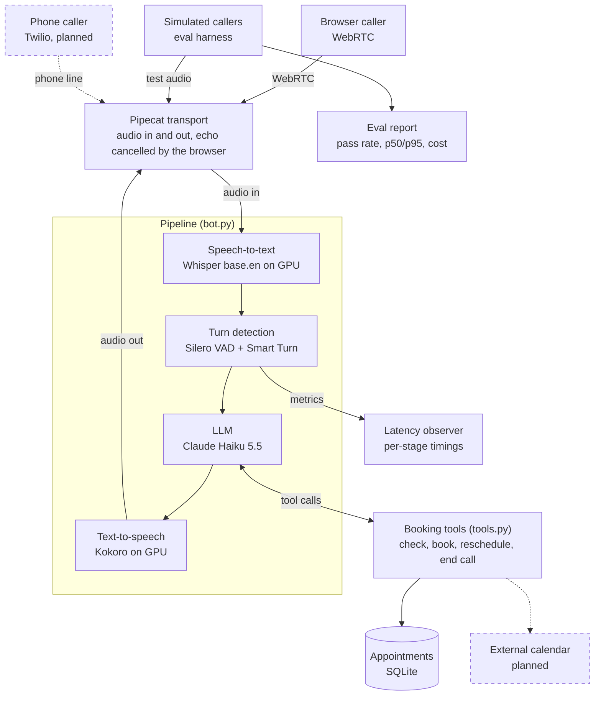
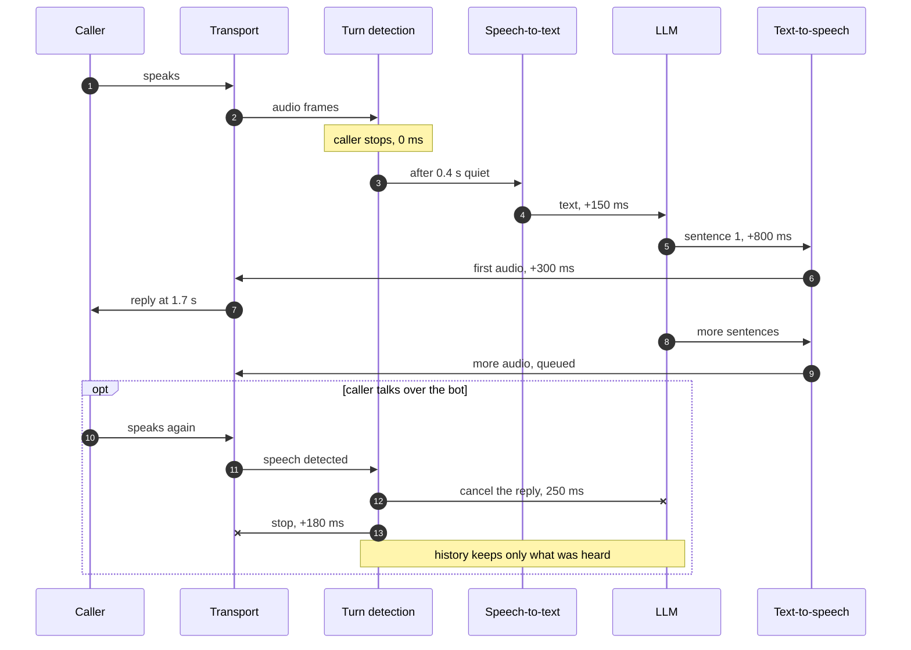
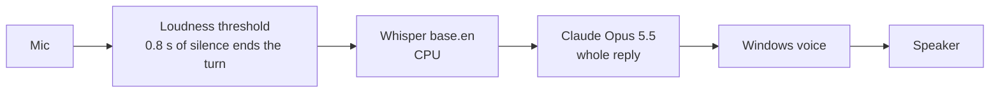
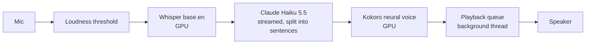
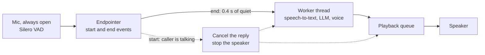
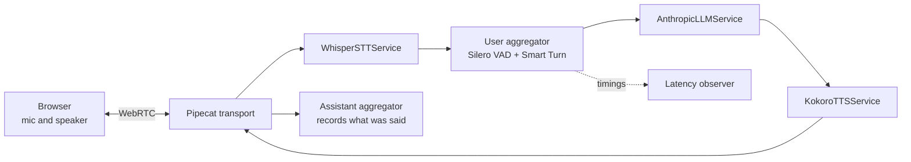
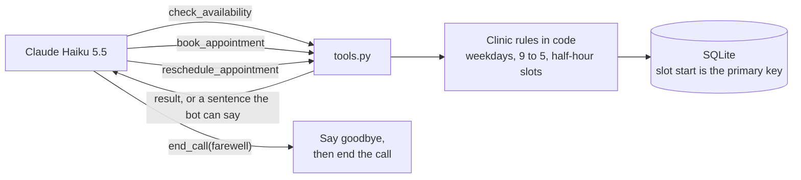
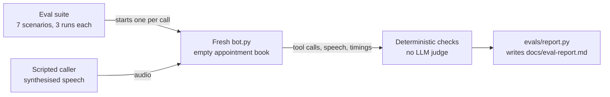

# Voice receptionist

A real-time voice agent that answers calls for a dental clinic: it listens, talks back, checks free
times, books and reschedules appointments, and hangs up when the caller is done.

It is built twice on purpose. `voice_loop.py` is the whole pipeline written by hand, so every stage and
every millisecond is visible. `bot.py` is the same receptionist rebuilt on [Pipecat](https://github.com/pipecat-ai/pipecat),
with a browser client, tools and an automated eval suite. The contrast between the two files is the point
of the project: what a voice framework gives you, and what you still have to understand yourself.

Everything runs locally except the LLM: speech-to-text is Whisper, the voice is Kokoro, voice detection is
Silero, and the model is Claude Haiku 5.5.

## System design

Solid boxes are built. Dashed boxes are planned.



Editable copies of the diagrams are in [docs/](docs): `system-design.drawio` and `turn-sequence.drawio`.

## One turn, with timings

Measured on the hand-built loop in phase 3. The clock starts when the caller stops talking.



## How it was built, phase by phase

Each phase is one or two commits, so the history reads in the same order as this section.

| Phase | What changed | Reply starts after the caller stops |
|---|---|---|
| 1 | Naive blocking loop | 3.2 s (live mic, median of 6 turns) |
| 2 | Streaming, GPU speech-to-text, faster model, neural voice | 2.15 s (simulated) |
| 3 | Always-on mic, interruptions, eager end of turn | 1.5 to 1.9 s (simulated and live) |
| 4 | Rebuilt on Pipecat with a browser client | 1.83 s on a clean live turn |
| 5 | Booking tools | Tool turns take two LLM round trips |
| 6 | Automated voice evals | p50 3.5 s, p95 4.6 s with the harness sharing the machine |

"Simulated" means synthetic caller audio fed through the real pipeline with playback muted. "Live" means a
person talking into a microphone.

### Phase 1: the naive loop

Everything blocks. The mic is only open while listening, the whole LLM reply is awaited, and then it is spoken.



Baseline over six live turns: 810 ms waiting for silence, 613 ms speech-to-text, 1,804 ms LLM, 3,248 ms in total.

### Phase 2: streaming and the GPU



| Change | Before | After |
|---|---|---|
| Stream the reply and speak the first sentence as it arrives | 1,440 ms | 1,186 ms |
| Claude Haiku 5.5 instead of Opus 5.5, to first sentence | 1,186 ms | 754 ms |
| Whisper on a GTX 1660 instead of the CPU (1.7 s clip) | 641 ms | 110 ms |
| Kokoro on the GPU instead of the CPU (2.8 s sentence) | 1,267 ms | 251 ms |

Streaming helped less than expected. The replies are one or two short sentences, so almost all of the wait
is before the first word arrives; the choice of model mattered more. A neural voice also has a price: it must
synthesise audio before it can play, which added about 0.4 s compared with the instant, robotic Windows voice.

### Phase 3: turn-taking

The mic never closes, and replies are produced on a worker thread that can be cancelled.



- **Interruptions.** Speech while the bot is thinking or talking cancels the reply. In simulation the stop was
  triggered 256 ms after the caller's voice began and the speaker was silent 177 ms later.
- **Eager end of turn.** The bot starts answering after 0.4 s of quiet instead of 0.8 s. If the caller was only
  pausing, the reply nobody heard is dropped and the whole utterance is answered once they finish.
- **Honest history.** After an interruption, the conversation history keeps only the sentences that were
  actually played.

Two performance traps showed up here. After about four idle seconds the GPU slows down, and speech-to-text went
from 150 ms to 400 ms; a tiny transcription every half second while idle keeps it at 150 ms. And starting a new
thread for every reply made voice synthesis about 130 ms slower than one long-lived worker.

### Phase 4: rebuilt on Pipecat



| Built by hand in `voice_loop.py` | Pipecat's version |
|---|---|
| Mic and speaker loop | WebRTC transport; the browser cancels echo |
| VAD plus eager end of turn | Silero VAD plus Smart Turn, a model that judges whether a sentence sounds finished |
| Interruption and "only what was heard" history | Built in |
| Sentence splitting and playback queue | Built in |
| The timing line | A latency observer |

The first live browser call went badly: the bot treated a noisy room as one long caller turn, was interrupted
28 times in 11 minutes, and replies started a median of 6.5 s late. The cause was the voice detector. Its
speech-confidence score cannot tell a near voice from a far one:

| Voice level | Speech-confidence score | Loudness score |
|---|---|---|
| Normal | 1.00 | 0.81 |
| Half | 1.00 | 0.75 |
| Quarter | 1.00 | 0.69 |
| One tenth | 1.00 | 0.61 |

Pipecat's default loudness threshold is 0.60, which lets a voice ten times quieter through. Raising it to 0.72
fixed it: in the next live call the bot accepted nine stretches of speech, all the caller's, and nothing during
two minutes of silence.

A second idea, requiring three recognised words before the bot could be interrupted, was tried and removed. It
made each turn wait for its transcript before starting, which added a fixed 0.8 s to every reply.

### Phase 5: booking tools



The rules live in code, not in the prompt, and the database itself refuses a double booking. When a request
breaks a rule, the tool returns a sentence the bot can say to the caller. The hang-up tool takes the farewell
as an argument because, left to say goodbye first, the model sometimes hung up in silence.

### Phase 6: evals



First full run: **17 of 21 calls passed.** The full report is in [docs/eval-report.md](docs/eval-report.md).

| Scenario | Passed | What it checks |
|---|---|---|
| Greeting | 3 of 3 | The bot speaks first and names the clinic |
| Book appointment | 3 of 3 | The right time, phone number and name reach the booking |
| Repeated digits | 0 of 3 | A phone number with many repeated digits |
| Reschedule | 3 of 3 | Books, then moves the appointment |
| Weekend refused | 2 of 3 | Says the clinic is closed on Saturday |
| Interruption | 3 of 3 | Stops talking within 1.5 s of the caller cutting in |
| Wrong number | 3 of 3 | Says goodbye and hangs up |

- **Repeated digits is a real bug.** Speech-to-text heard "741 333 3333" as "741-333-333" every time. A larger
  Whisper model was tested and did not help: both models got 7 of 8 spoken numbers right offline, and the larger
  one was about three times slower. The scenario stays in the suite as a known failure. On a real phone line the
  fix is caller ID or keypad entry, not a bigger model.
- **The weekend failure was a flaw in the check,** which read a silent tool call as an empty reply. With the
  check fixed, that scenario passed 3 of 3 in a separate rerun.
- **The evals changed the bot.** They showed it asking for confirmation twice before booking; it now confirms
  once and books on the first yes.

Reply latency in the eval run was p50 3.5 s and p95 4.6 s over 16 replies. That is slower than a live call,
because most of those replies needed a tool call and the harness shares the machine's CPU and GPU with the bot.
LLM cost came to about $0.001 per minute of call at Haiku 5.5 list price; speech-to-text and the voice run
locally.

## Run it

Tested on Windows 10 with Python 3.13, an Intel i5-10400F and a GTX 1660 (6 GB). An NVIDIA GPU is optional but
everything is much slower without one; on a machine without one, leave the last three lines out of
`requirements.txt`.

```powershell
python -m venv .venv
.\.venv\Scripts\pip install -r requirements.txt
$env:ANTHROPIC_API_KEY = "your-key"
```

Check the pieces without a microphone. The first run downloads the Whisper model and the 350 MB voice model:

```powershell
.\.venv\Scripts\python voice_loop.py --check
.\.venv\Scripts\python tools.py --check
```

Talk to the hand-built loop. Use a headset; it has no echo cancellation:

```powershell
.\.venv\Scripts\python voice_loop.py
```

Talk to the Pipecat bot in a browser. Open http://localhost:7860/client, click Connect and allow the microphone:

```powershell
.\.venv\Scripts\python bot.py
```

Run the evals and write the report:

```powershell
$env:APPOINTMENTS_DB = "fresh"
.\.venv\Scripts\python -m pipecat.evals suite evals\manifest.yaml --repeat 3
.\.venv\Scripts\python evals\report.py
```

## Files

| File | What it is |
|---|---|
| `voice_loop.py` | The pipeline by hand: VAD, endpointing, speech-to-text, LLM streaming, voice, interruptions |
| `bot.py` | The same receptionist on Pipecat, with a browser client |
| `tools.py` | The appointment book and the tools the LLM can call |
| `evals/` | Scripted voice scenarios, the suite manifest and the report script |
| `eval_services.py` | The simulated caller's voice for the eval harness |
| `docs/` | The eval report and the editable diagrams |

## Known limits and what is next

- **No phone number yet.** The plan is Twilio, which also brings caller ID and so removes the need to hear a
  phone number at all.
- **The calendar is a local SQLite file,** not an external calendar service.
- **Not deployed.** It runs on one machine with a local GPU.
- **Any speech interrupts the bot,** including a short "mm-hm".
- **History is trimmed to whole sentences** after an interruption, not to the exact word.
- **Short words and names are sometimes misheard** by the small speech model, which is why the bot reads the
  name and number back before booking.
